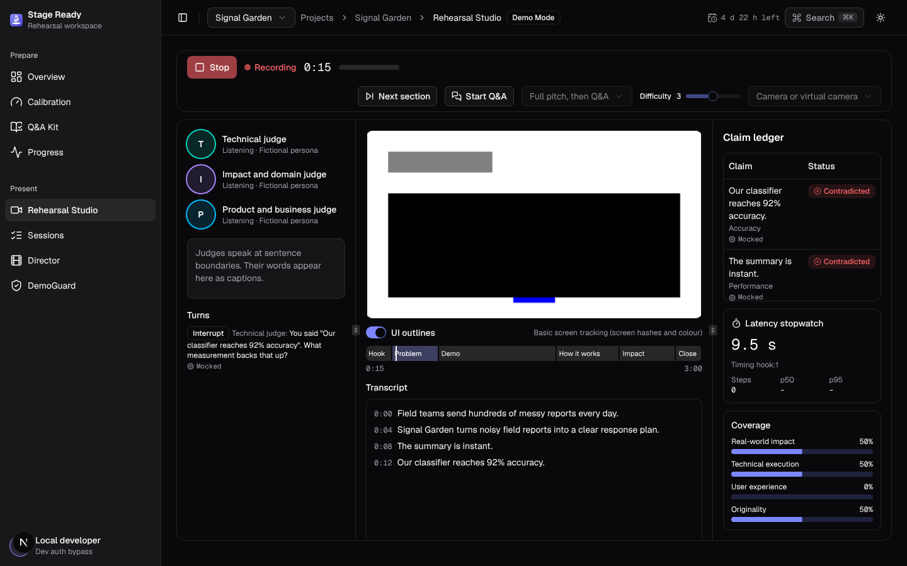
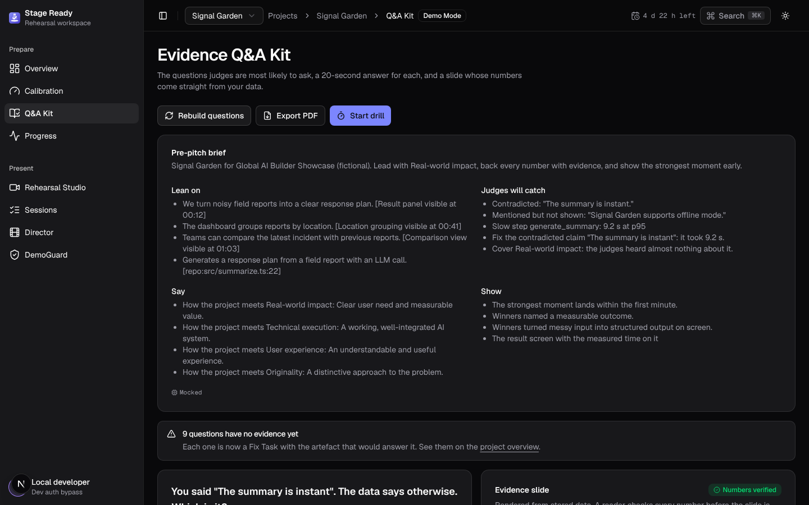
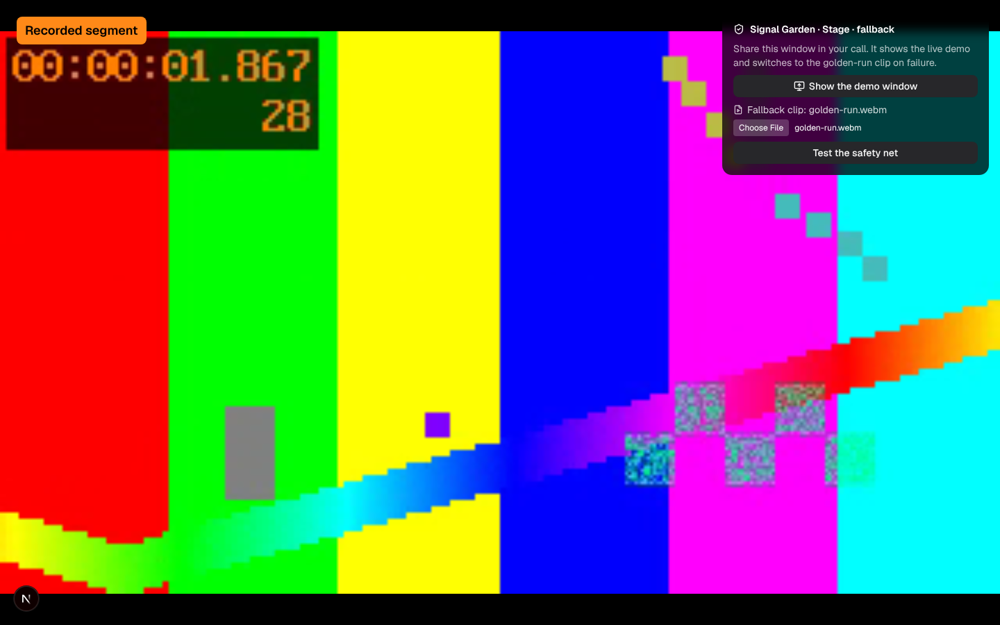
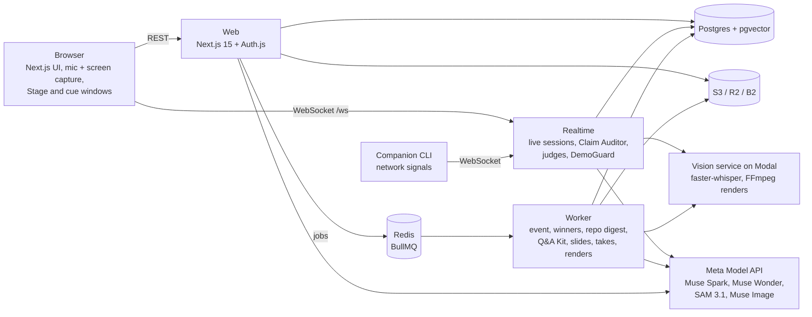

# Stage Ready

**Rehearse against honest judges. Present with a safety net.** Fictional judges built from your event's real criteria interrupt your rehearsal, a Claim Auditor checks every claim against your screen, your code and your measured timings, and DemoGuard switches to a recorded clip if your live demo fails.

[](https://github.com/m40ma0/GrillMe/actions/workflows/ci.yml)

**Try it live:** https://x4yees--stage-ready.modal.run → **Try Demo Mode**. No sign-up: a guest workspace with a fictional project, running on the real Meta models within a daily allowance. If it has been idle it takes about a minute to wake up.

**Product clip:** [`apps/web/public/clip.mp4`](apps/web/public/clip.mp4) (20 s, recorded from the app). Demo video: _link to add after recording_.

| Rehearsal Studio                                                                                                                    | Q&A Kit                                                                                             | DemoGuard switch                                                                                                 |
| ----------------------------------------------------------------------------------------------------------------------------------- | --------------------------------------------------------------------------------------------------- | ---------------------------------------------------------------------------------------------------------------- |
|  |  |  |

Built for the Meta Global AI Developer Hackathon.

## How Meta models power it

Every judge line, claim, Coach Note, question and brief shows which model produced it and how long it took ("Muse Spark 1.3 · 1.9 s"), or "Mocked".

| Model                                                                          | What it does                                                                                                                                                                                                                                                                                         | Where in code                                                                                                                                                                                 |
| ------------------------------------------------------------------------------ | ---------------------------------------------------------------------------------------------------------------------------------------------------------------------------------------------------------------------------------------------------------------------------------------------------- | --------------------------------------------------------------------------------------------------------------------------------------------------------------------------------------------- |
| **Muse Spark 1.3** (`muse-spark-1.3`, reasoning low; claim extraction minimal) | Live calls: extracts claims from each sentence, verifies them with the two nearest screenshots, decides when a judge interrupts and what they say, show-or-strike over demo frames, checks every number on a rendered evidence slide, confirms DemoGuard expected-state mismatches from a screenshot | `packages/ai/src/prompts/claimExtract.v1.ts`, `claimVerify.v2.ts`, `judgeTurn.v1.ts`, `showOrStrike.v1.ts`, `slideVerify.v1.ts`; `apps/realtime/src/demoguard/session.ts` (`confirmMismatch`) |
| **Muse Wonder 1.0** (`muse-wonder-1.0`, reasoning high, long context)          | Reads the event page into a cited EventSpec, past winners into patterns, the repo into capabilities with `file:line`, and everything at once into the pre-pitch brief and the ranked question bank; writes Coach Notes and the post-session audit                                                    | `packages/ai/src/prompts/eventSpec.v1.ts`, `winnerProfile.v1.ts`, `winningPatterns.v1.ts`, `repoCapabilities.v1.ts`, `questionBank.v2.ts`, `coachNotes.v1.ts`, `sessionAudit.v1.ts`           |
| **SAM 3.1** (`sam-3.1`, hosted)                                                | Finds error dialogs, spinners and progress bars on the shared screen; the boxes are drawn on the Studio preview and DemoGuard's watched screen, and drive the latency stopwatch and failure detection                                                                                                | `packages/ai/src/sam.ts`, `apps/realtime/src/vision/tracker.ts`                                                                                                                               |
| **Muse Image 1.0** (`muse-image-1.0`)                                          | Paints the Director's intro and outro title-card backgrounds (the text is drawn by the renderer, so names are exact)                                                                                                                                                                                 | `packages/ai/src/image.ts`, `apps/worker/src/jobs/takes.ts`                                                                                                                                   |

All calls go through the Responses API at `https://api.meta.ai/v1` with JSON-schema output validated by zod and one corrective retry (`packages/ai/src/meta.ts`). Run `pnpm ai:check` with your key to test every model.

## Architecture



A pnpm and Turborepo monorepo: `apps/web`, `apps/realtime`, `apps/worker`, `apps/companion`, `packages/shared` (zod contracts for every REST and WebSocket message), `packages/ai` (versioned prompts with deterministic mocks), `packages/db` (Drizzle), `packages/config`, and `services/vision` (Python). Details in `docs/architecture.md`.

## Features

- **Judge Panel.** Three fictional personas built from the event's criteria interrupt at sentence boundaries, yield when you say "let me finish", and ask follow-ups to vague answers.
- **Claim Auditor.** Every claim becomes a chip: Verified, Contradicted, Unverified or Not shown, with evidence (a measured time, a `file:line`, a screenshot) and an honest rewrite. "It's instant" before a 9.2 s step is contradicted with the stopwatch reading.
- **Calibration.** The event page becomes a cited EventSpec, past winners become patterns, the repo becomes capabilities and findings.
- **Evidence Q&A Kit.** A pre-pitch brief, 20+ ranked questions with 55-word answers, and evidence slides whose numbers are checked after rendering; Cmd+K puts a backup slide on screen in under 2 s.
- **Best-Take Director.** Scores every take, assembles the best per section within the time limit, and renders a captioned MP4 at −14 LUFS with SRT, thumbnail and chapters.
- **DemoGuard.** Watches the live demo; on an error dialog, a 5xx or two corroborating signals, the Stage window crossfades to the golden-run clip at that step with a Recorded segment badge, and cuts back at the next step boundary. Test it any time with "Test the safety net".
- **Rehearsal Memory.** Coach Notes resolve a weak spot only when a later session re-checks it and it passes, and plan the next three things to practise.

## What is real and what is mocked in Demo Mode

Demo Mode is a fictional project (Signal Garden) so anyone can try the product without a repo, a key or a microphone.

| Real models (live site, within the daily demo allowance)                                                                                                                       | Scripted or fixed                                                                                                                                                   |
| ------------------------------------------------------------------------------------------------------------------------------------------------------------------------------ | ------------------------------------------------------------------------------------------------------------------------------------------------------------------- |
| Claim extraction and verification, judge turns, show-or-strike (Muse Spark); Coach Notes, the question bank and the pre-pitch brief (Muse Wonder); SAM 3.1 boxes in the Studio | The presenter's speech (a scripted transcript), the fake screen, the 12 Director takes (labelled colour bars), the seeded earlier session, and DemoGuard's scenario |

Past the daily allowance, or locally without a key, every model call is answered by the prompt's deterministic mock and captioned "Mocked". Real projects (signed in with GitHub) use the real models for everything.

## Local setup

Requirements: Node.js 22, pnpm 11, Docker Compose, Python 3.12 and FFmpeg.

```sh
cp .env.example .env
pnpm install
docker compose up -d
pnpm db:migrate
pnpm db:seed
pnpm dev
```

The web app is on http://localhost:3000, realtime on :4000, the worker's health on :4100. Demo Mode needs nothing else. For real projects, start the vision service (speech to text, takes, renders):

```sh
cd services/vision
python3.12 -m venv .venv
.venv/bin/pip install -r requirements-dev.txt
.venv/bin/python -m uvicorn app.main:app --reload --port 8000
```

To use the Meta models, put your key in `.env` (`META_API_KEY`) and run `pnpm ai:check`; it tests each model and prints the settings to use. If the pinned MinIO image does not pull, use the moto S3 server instead (`pip install "moto[server]==5.1.4"` then `moto_server -p 9000`), as CI does.

## Deploy

`docs/deploy.md`: Postgres with pgvector, Redis and S3-compatible storage, the vision service on Modal, and either any Node host or the free single-container deploy on Modal (`deploy/modal/stage_ready.py`). Services refuse to boot in production with placeholder secrets, `ws://` URLs, the dev auth bypass, or no vision-service token.

## Tests and CI

```sh
pnpm lint && pnpm format:check && pnpm typecheck && pnpm test && pnpm build
pnpm test:e2e                                    # Playwright: Demo Mode, fake camera, mic and screen, a signed-out guest server
cd services/vision && .venv/bin/python -m pytest
```

CI runs all of them on every push. `docs/acceptance.md` maps every acceptance criterion to the test that proves it.

## Decisions

Every milestone's decisions, including what is not built and what could not be verified, are in `docs/decisions/` (`0007-review-fixes.md` covers the review fixes). The milestone history is in `docs/history.md`.

## Privacy and safety

Fixture data is fictional. Event, winner and repo content is untrusted data, never instructions, and model special tokens in it are neutralised. Recordings stay on your computer unless the project opts into cloud upload. Judge personas are always fictional, the Recorded segment badge is on by default, and Stage Ready never writes to your repo.

## Team

Liang Ang Yee ([@m40ma0](https://github.com/m40ma0)).

## Licence

MIT, see [LICENSE](LICENSE).
