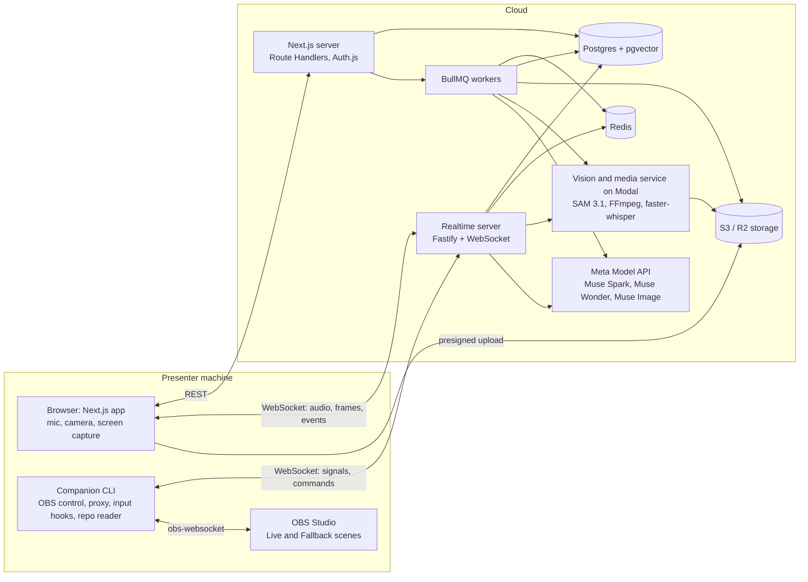
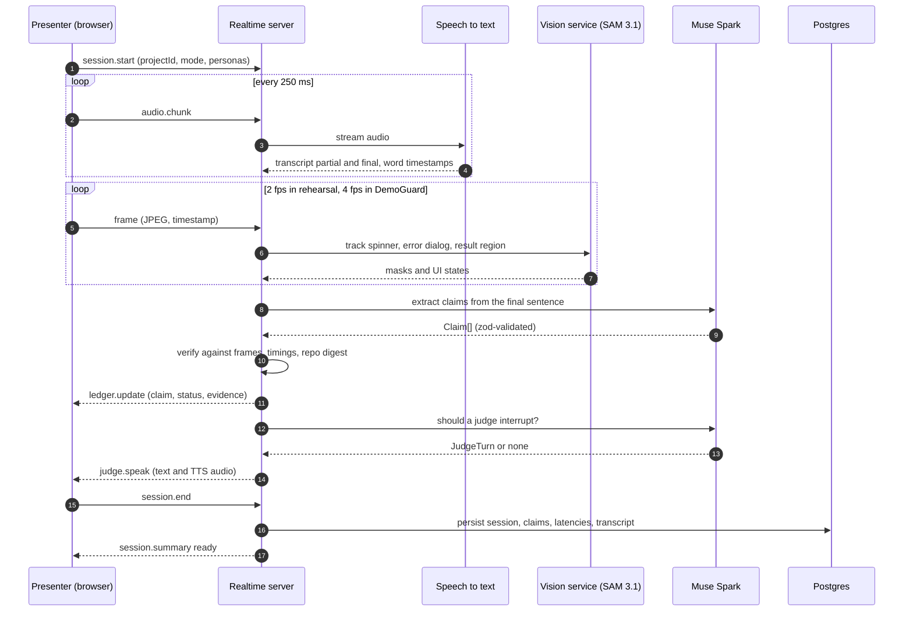
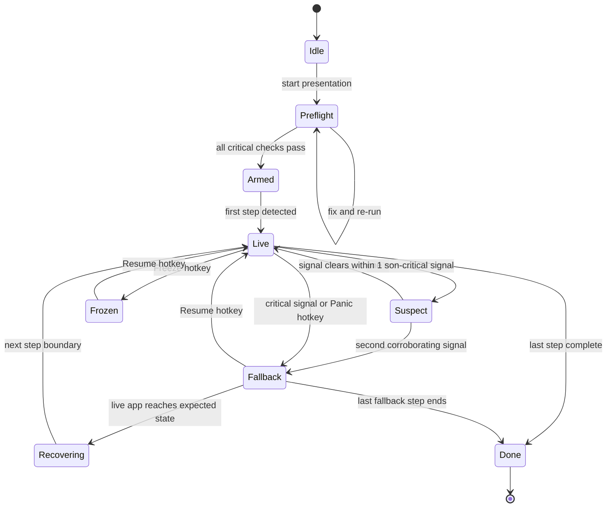
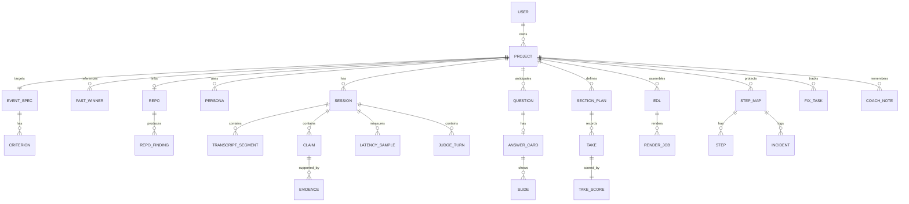
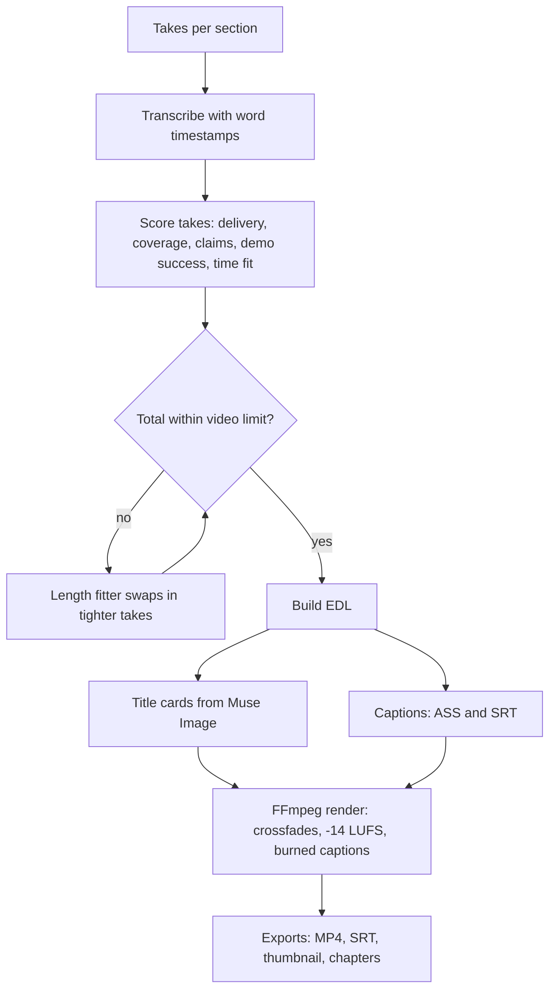
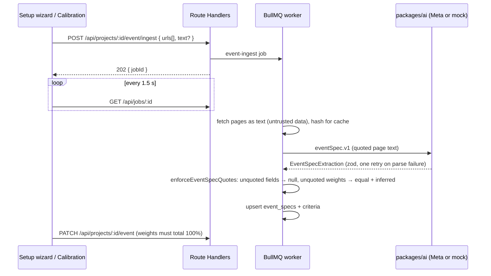

# Architecture

Copied from `docs/BUILD_PROMPT.md` ("Diagrams") and kept in sync with the code. Status notes below each diagram say what exists today.

## System architecture

The browser and the companion both talk to the realtime server; heavy work runs in queued jobs and on Modal.

Status (M2): web, worker (`event-ingest`, `winners`, `repo-digest`), realtime (live sessions), Postgres, Redis and S3 are live. All model access goes through `packages/ai` (Meta chat-completions adapter, or the mocked adapter when no key is set or the project is in Demo Mode), traced with OpenTelemetry. The vision service serves streaming STT (faster-whisper), SAM 3.1 tracking (when a checkpoint is configured) and frame hashes. The companion connects in M5.

## Live rehearsal sequence

Every final sentence triggers claim extraction, verification and an interruption decision.

Status: built in M2 (`apps/realtime/src/session/live-session.ts`). Deterministic rules (`auditor/rules.ts`) run before the verify call; the interruption decision is gated by `judges/policy.ts`. In Demo Mode, STT is the scripted provider.

## DemoGuard state machine

One critical signal, or two corroborating ones, moves Live to Fallback; recovery waits for a step boundary.

Status: M5.

## Core data model

The project is the root; sessions, takes and step maps hang off it. All 28 tables exist in `packages/db/src/schema.ts` (uuid v7 ids, `createdAt`, `updatedAt`, `projectId` on every child).

## Best-Take render pipeline

The length fitter loops until the assembled cut fits the event's limit.

Status: M4.

## M1 ingestion flow

