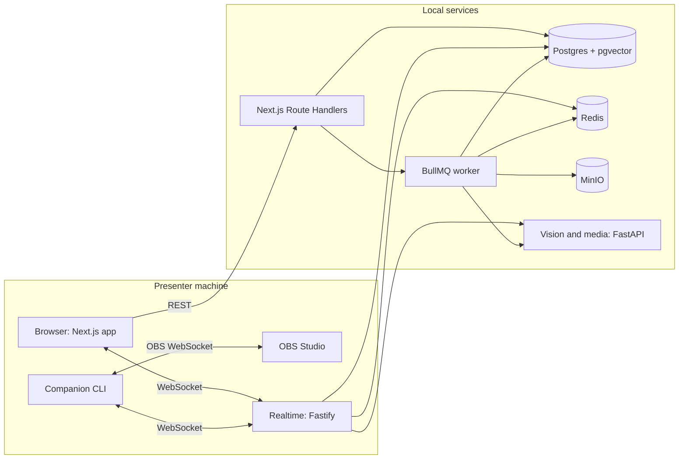

# Architecture

The browser and local companion connect to the realtime server. Background analysis runs in the BullMQ worker, persists in PostgreSQL, and can use the local S3-compatible MinIO service. The Python service owns vision and media workloads.

## Runtime boundaries

- `apps/web`: Next.js App Router UI, server-side routes, shared UI and theme.
- `apps/realtime`: Fastify WebSocket endpoint for live session events.
- `apps/worker`: BullMQ worker for jobs that run outside interactive latency paths.
- `apps/companion`: local process boundary for OBS and presenter-machine integration.
- `services/vision`: Python 3.12 FastAPI boundary for vision and media processing.
- `packages/shared`: zod contracts shared across server and client.
- `packages/db`: PostgreSQL schema, Drizzle migrations and Demo Mode seed.

The local fixture is clearly fictional and only supplies the UI during Demo Mode. Model identifiers and endpoints are configured from environment variables and are left blank until verified against official documentation.
